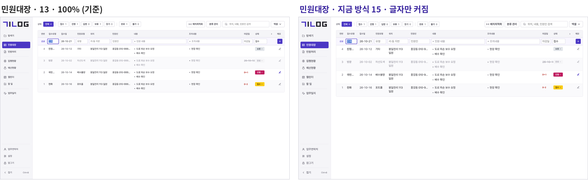
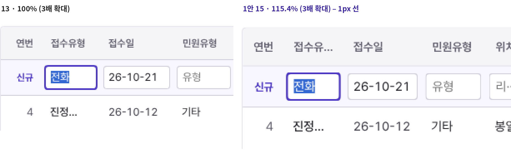
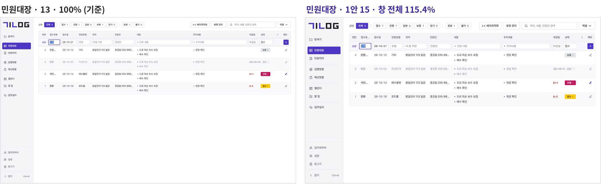
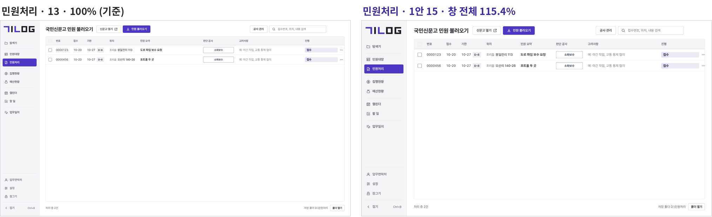
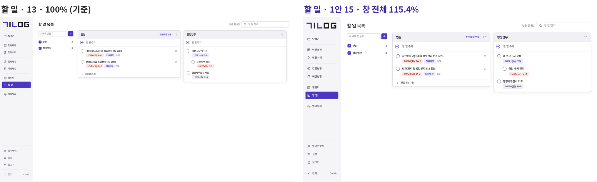
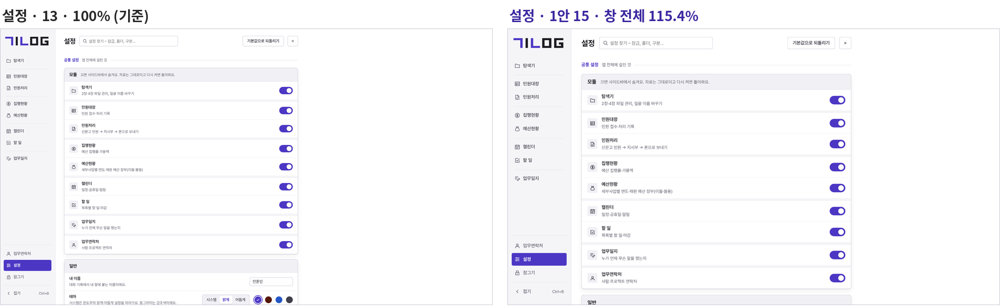

# 화면 배율 검토 (2026-10-21 화면 배율 세션)

**사용자 요청(18:29)**: 회사에 노안인 분이 많아 글자를 더 키워야 해요. 지금까지 UI를 13px 기준으로 맞춰 왔으니, 글자 크기가 바뀌어도 13px일 때와 최대한 같은 비율로 구성 요소가 보이는 규칙을 만들어요.

기준은 main `c67210a`(0.30.0). 이 문서는 검토만 해요(코딩 없음). 결정되면 공통 결정 로그·대기 목록 "화면 배율"에 적고, 사용자가 "코딩하자"라고 할 때 `wip/scale`에서 한 번에 해요.

## 1. 지금 상태

- 설정 → 일반 "글자 크기" `prefs.fontSize`(12·13·14·15, `src/SettingsScreen.tsx` 276줄) → `App.tsx` 94줄이 `--fs`만 바꿔요. `--fs-sm` 12.5·`--fs-xs` 12·`--fs-badge` 11.5(`tokens.css` 168~171줄)는 고정이라 따라오지도 않아요.
- 칸 높이(28·34)·배지 22·줄 높이·여백·아이콘 16/14/10·모서리 6/8/14·사이드바 180·열 폭은 모두 px 고정이에요. 다시 센 값:
  - `src/app.css` 11,990줄 안 px 값 **2,366개**(그중 `1px` 있는 줄 354줄)
  - 화면 tsx 안 `style={{…}}` 91곳, 숫자로 쓴 폭·높이 24곳, px 글자 37곳
  - 자리를 재서 메뉴·창을 놓는 `getBoundingClientRect` 67곳, 글자 폭을 재는 캔버스 4파일(민원대장·업무연락처·탐색기 열 폭, 머릿기호 `bullets.ts`, `ruler.ts`)
  - `VirtualList` 줄 높이 어림값 2곳(민원대장·업무연락처, 잰 값이 먼저라 어림값은 처음 한 번만 씀)
- 그래서 15로 바꾸면 **본문 글자만 커지고** 머리 줄(12px)·배지·아이콘·칸 높이는 그대로예요 → 위치가 두 줄로 꺾이고, 머리 줄 글자는 오히려 작아 보여요.

## 2. 방식 세 가지

### 1안 창 전체 배율(WebView2 확대)

- Rust `window.rs`에서 창을 만든 뒤 `webview.set_zoom(크기 ÷ 13)` 한 줄(설정을 바꾸면 그 자리에서 다시 부름). `--fs`는 13에 고정.
- **CSS `zoom`이 아니라 WebView2 확대예요.** WebView2 확대는 윈도우 배율과 같은 원리라(화면 폭을 CSS px로 줄이고 devicePixelRatio를 키움) 자리 재기 67곳·캔버스·`VirtualList`가 손대지 않아도 맞아요. 뿌리 요소 CSS `zoom`은 `innerWidth`·마우스 좌표와 잰 자리가 서로 다른 단위가 되는 곳이 생겨 67곳을 다 봐야 해요.
- 크기별 비율: 12 = 92.3% · 13 = 100% · 14 = 107.7% · 15 = 115.4% · 16 = 123.1% · 17 = 130.8%. 1600×900 창 안 CSS 폭: 1600 · 1486 · 1387 · 1300 · 1224.
- 1px 선: 크로미움이 테두리를 실제 화면 점 단위로 맞춰 그려서 **흐리지 않고 1점으로 남아요**(아래 확대 그림). 다만 칸·줄 자리가 반 점에 걸리는 곳은 간격이 1점씩 들쭉날쭉할 수 있어요 — 윈도우 125%에서 받아들인 것과 같은 종류예요.

### 2안 기준 단위 토큰

- `--u` = 글자 크기 ÷ 13, app.css px 2,366개를 `calc(var(--u) * N)`으로 바꾸고 tsx 인라인 값·`VirtualList` 어림값·캔버스 재기 글꼴·`ruler.ts`를 함께 고쳐요.
- 크기마다 값을 정수로 떨어뜨릴 수 있어(예: 28 → 15일 때 32) 선·간격이 또렷해요. 하지만 반올림이 칸마다 달라 "13일 때와 같은 비율"이 오히려 조금씩 흐트러지고, 모든 화면 파일을 건드려 다른 세션과 겹쳐요. 큰 공사(며칠).

### 3안 섞기

- 1안 확대 + 1px 선·테두리·그림자만 `calc`로 보정. 그런데 위 그림처럼 1px 선은 확대만으로도 1점으로 남아서, 보정할 몫이 거의 없어요.

## 3. 미리 보기 (브라우저 1600×900 · 밝게 · 왼쪽 13 기준, 오른쪽 1안 15)

1안은 실제 WebView2와 같은 방식(CSS 화면 1387×780 + 배율 1.154 → 그림 1600×900)으로 찍었어요. 찍은 도구는 [scale/scale_shoot.py](scale/scale_shoot.py).

## 4. 창 안에 들어가는지 (1안, 1600×900, 10화면 × 13~17)

| 화면 | 13 | 14 | 15 | 16 | 17 |
| --- | --- | --- | --- | --- | --- |
| 탐색기·민원대장·할 일·업무일지·업무연락처·설정 | ✓ | ✓ | ✓ | ✓ | ✓ |
| 캘린더 | ✓ | ✓ | ✓ | ✓ | 21px 넘침 |
| 민원처리 | ✓ | ✓ | 6px 넘침 | 12px 넘침 | 29px 넘침 |
| 집행현황(표 폭 1192 고정) | ✓ | ✓ | 표 안 가로 스크롤 43 | 130 | 206 |
| 예산현황(표 폭 1454 고정) | 표 안 가로 스크롤 92(지금도) | 206 | 305 | 392 | 468 |

- 창 전체 가로 스크롤은 어느 크기에서도 없어요. 넘침은 모두 표 안쪽이에요.
- 민원대장은 열 폭 비율이 창 폭을 따라가서 들어가지만, 15부터 좁은 열 머리("접수유형" → "접수유…")·완료 줄 마감일이 잘려요 — 열 최소 폭 확인 필요.
- 민원처리는 자동 폭이 몇 px 모자라요(코딩 때 최소 폭 다시 셈). 캘린더 17은 왼쪽 열 고정 폭 때문.

## 5. 함께 본 것

- **윈도우 125% PC**: 앱 배율과 곱해져요(1.25 × 1.154 = 1.44). 하지만 창 안 CSS 폭은 윈도우 배율과 상관없이 같아서(15면 늘 1387) **배치는 100% PC와 똑같고 점만 더 촘촘**해요. 125% 확인 절차는 없으니(결정 로그 10-21 14:36) 따로 재지 않아요.
- **Ctrl+휠·Ctrl+±**: `tauri.conf.json`에 `zoomHotkeysEnabled`가 없어 지금은 꺼져 있어요(기본 꺼짐). 켜면 손 닿는 대로 배율이 바뀌고 저장 값과 어긋나며, 탐색기 대기 항목 "Ctrl+휠 아이콘 크기"와 겹쳐요.
- **제외**: 트레이 메뉴·윈도우 알림(윈도우가 그림), 엑셀(파일). 잠금 화면은 같은 창이라 1안이면 저절로 함께 커져요(prefs.json은 잠금 전에 읽혀요) — 따로 손대지 않아요. 업무일지 인쇄(`window.print`)는 크로미움이 화면 확대를 인쇄에 쓰지 않아 그대로일 것으로 봐요 — 코딩 때 인쇄 미리 보기로 확인.
- **창 최소 크기** 1024×700(실제 점)은 17이면 CSS 783×535가 돼요 — 최소 크기를 배율에 맞춰 늘릴지 코딩 때 정해요(권함: 그대로, 작게 줄이면 표 안 스크롤).
- **모양 지킴이**: 13·100% 장면 39개는 0점 그대로여야 해요(1안은 13일 때 바뀌는 게 없음). 새 장면으로 화면 10개 × 15·17을 더해요(`shoot.py`에 배율 값 하나 — 위 도구와 같은 방식).
- **이름**: 글자만이 아니라 화면 전체가 커지니 설정 줄 이름을 "글자 크기" → "화면 크기"로, 저장 값 `fontSize`는 그대로 써요(12~15를 고른 사람은 같은 단계로 이어져요).

## 6. 결정 (2026-10-21 18:43 사용자 — ①~④ 모두 1안)

대기 목록 "화면 배율" ✔1~4로 쌓았어요. 아래 표는 물었던 그대로 남겨요.

### ① 방식

| 안 | 내용 | 좋은 점 | 걸리는 점 | 권함 |
| --- | --- | --- | --- | --- |
| 1안 | 창 전체 배율(WebView2 확대, 크기 ÷ 13) | 모든 요소가 13 때와 똑같은 비율 · 고칠 곳 몇 줄 · 다른 세션과 안 겹침 | 반 점에 걸린 간격이 1점씩 들쭉날쭉할 수 있음(125%와 같은 종류) · 창에 들어가는 양이 줄어듦 | ✔ 요청("같은 비율")을 그대로 지키고 공사가 작아요 |
| 2안 | 기준 단위 토큰(px 2,366개 + tsx를 `--u` 곱으로) | 크기마다 정수로 맞춰 선이 또렷 | 큰 공사 · 모든 화면 파일을 건드림 · 반올림으로 비율이 조금씩 틀어짐 | |
| 3안 | 1안 + 1px 선만 보정 | 1안보다 선을 더 다듬을 수 있음 | 1px 선은 이미 1점으로 남아 얻는 게 적음 | |

### ② 크기 단계

| 안 | 내용 | 좋은 점 | 걸리는 점 | 권함 |
| --- | --- | --- | --- | --- |
| 1안 | 작게 12 · 보통 13(처음 값) · 조금 크게 14 · 크게 15 · 더 크게 16 · 아주 크게 17, 옆에 % 표시 | 지금 고른 값 그대로 이어짐 · 노안용 16·17 | 단계가 여섯 | ✔ 1안 방식이면 단계를 더해도 비용이 없어요 |
| 2안 | 13~17 다섯(12 없앰, 12였던 사람은 13) | 단계가 단순 | 12로 많이 보던 사람이 바뀜 | |
| 3안 | 12~16(17 없음) | 17의 넘침(민원처리·캘린더)을 안 다뤄도 됨 | 노안이 심한 분께 모자랄 수 있음 | |

### ③ 기준 창 1600×900에 다 안 들어갈 때

> **2026-10-26 16:44 창 크기 세션 결정으로 바뀜**([viewport.md](viewport.md)) – 열·칸을 줄이지 않고 화면마다 최소 폭 아래에서 본문 가로 스크롤. 아래 표는 물었던 그대로 남겨요.

| 안 | 내용 | 좋은 점 | 걸리는 점 | 권함 |
| --- | --- | --- | --- | --- |
| 1안 | 창 가로 스크롤 없이 열·칸이 줄어드는 지금 규칙을 확인 · 몇 px 넘는 민원처리·캘린더 17·민원대장 좁은 열만 손봄 · 집행현황·예산현황은 지금처럼 표 안 가로 스크롤 | 어떤 창 크기에서도 씀 | 큰 배율에서 좁은 열이 잘림("…") | ✔ 지금도 열 폭이 창을 따라가서 손볼 곳이 세 군데예요 |
| 2안 | 1안 + 16·17을 고르면 "창을 최대화하면 더 많이 보여요" 한 줄 안내 | 사용자가 알기 쉬움 | 안내 문구 하나 더 | |

### ④ Ctrl+휠·Ctrl+± 임시 배율

| 안 | 내용 | 좋은 점 | 걸리는 점 | 권함 |
| --- | --- | --- | --- | --- |
| 1안 | 끔(지금처럼) — 배율은 설정에서만 | 실수로 바뀌지 않음 · 탐색기 Ctrl+휠과 안 겹침 | 잠깐 키우기 불편 | ✔ 설정 값과 화면이 늘 같아요 |
| 2안 | 켬 — 바꾼 값은 앱을 다시 켜면 설정 값으로 | 잠깐 키우기 쉬움 | 탐색기 Ctrl+휠과 겹침 · 설정과 화면이 달라 헷갈림 | |
